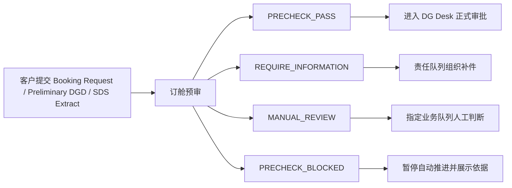

# Booking Precheck Workshop 业务词汇表

## 1. 业务边界

订舱预审位于客户提交资料之后、DG Desk 正式审批之前。它检查“资料是否足够、不同单据是否一致、当前教学规则是否允许自动推进”，不负责确认真实危险品分类，也不产生最终订舱批准或拒绝。

## 2. 三类单证

| 名称 | 在样例中的用途 | 不代表什么 |
|---|---|---|
| Booking Request | 客户的订舱意图，包括航线、船期、交易方、货物、设备、件数和重量 | 不代表承运人已确认舱位 |
| Preliminary DGD | 客户在预审阶段提供的危险品申报事实，包括 UN Number、PSN、Class、Packing Group、包装和声明状态 | 不是正式法律文件模板，也不是系统自行生成的危险品分类 |
| SDS Extract | 从 SDS Section 1、9、14 抽取的教学摘录 | 不是完整的 16 节 SDS，也不能用于真实安全或运输决策 |

## 3. 核心事实

| 术语 | 教学含义 |
|---|---|
| UN Number | 运输分类标识；样例只比较不同单据是否一致，不由 Agent 自行确定 |
| Proper Shipping Name / PSN | 运输专用名称；不能用普通商品描述代替 |
| IMDG Class | 样例中的危险品类别事实；系统只读取和比较客户资料 |
| Packing Group | 包装等级事实；`null` 可能是业务上不适用，也可能是字段缺失，必须结合规则解释 |
| Marine Pollutant | DGD 与 SDS 之间需要比较的布尔声明 |
| Flash Point | Class 3 教学规则使用的 SDS Section 9 数值事实 |
| ETD | 预计离港日；用于文档截止和快照有效期判断 |
| ETA | 预计到港日；用于目的设施临时运营限制判断 |

## 4. 规则与证据

| 术语 | 定义 |
|---|---|
| Policy Snapshot | 在指定时间冻结的一组机器可执行教学规则；同一输入加同一快照应得到相同结果 |
| Policy Variant | 经 Policy Owner 明确授权的快照变化，只记录相对基线的修改及生效原因 |
| Field Evidence | 支撑标准化事实的单据 ID、页码和原文 |
| Policy Evidence | 支撑规则解释的 Policy ID、页码、Rule ID 和原文 |
| Rule Match | 输入事实满足某条规则条件；所有命中都必须保留 |
| Aggregation | 按状态优先级计算最终状态，但不丢弃较低优先级原因 |

## 5. 四种状态

| 状态 | 回答的问题 | 后续动作 |
|---|---|---|
| PRECHECK_PASS | 当前资料和快照下，是否未发现需要暂停、补件或人工处理的问题？ | 进入后续 DG Desk 审批 |
| REQUIRE_INFORMATION | 是否缺少完成预审所需的单据或字段？ | 由责任队列一次性组织补件 |
| MANUAL_REVIEW | 是否存在不能由当前快照自动解决的冲突、低置信度或例外？ | 路由到指定队列判断 |
| PRECHECK_BLOCKED | 是否有明确事实要求暂停自动推进？ | 暂停自动流程并展示全部依据；不等于最终拒载 |

## 6. Routing Queue

`routing_queue` 表示当前问题的业务责任归属，不必然表示“人工审批”：

- `DOCUMENT_DESK`：组织补件、确认文档版本、处理重量或件数问题；
- `DG_DESK`：处理危险品事实冲突或需要专业批准的例外；
- `ROUTE_DESK`：处理航线范围和合作伙伴运营问题；
- `POLICY_OWNER`：处理快照过期或规则冲突。

`PRECHECK_BLOCKED` 可以暂时没有 Routing Queue，因为其首要动作是 `pause_automation=true`；生产系统中的后续归属不在本教学样例范围内。

## 7. 两个容易混淆的字段

- `collect_all_matches=true`：即使命中阻断规则，也继续评估其他规则并收集全部原因。
- `pause_automation=true`：停止业务流程自动向下推进，不表示停止规则评估。
