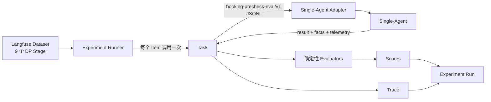

# 用 Langfuse 评测 Booking Precheck Agent：从零到第一轮 Experiment

这份教程复盘我们如何为 `agent/` 中的 Single-Agent 基线建立第一套 Langfuse 离线评测。完成后，你将能：

1. 理解 Dataset、Task、Evaluator、Score、Trace 和 Experiment Run 的关系；
2. 将 9 个 Document Pack Stage 同步到 Langfuse；
3. 通过统一黑盒协议运行 Single-Agent；
4. 在 Langfuse 中定位失败案例；
5. 以后使用相同 Dataset 公平比较 Multi-Agent。

本教程基于 Python SDK `langfuse==4.14.4`。Langfuse 官方也把这种流程定义为 Offline Evaluation：在固定 Dataset 上运行应用、生成 Scores、比较不同实现。[Evaluation Core Concepts](https://langfuse.com/docs/evaluation/core-concepts)

## 1. 先建立正确的心智模型

Langfuse 没有替代我们的 Harness，也不会自动理解 Booking Precheck 的业务规则。两者分工如下：

| 组件 | 在本项目中的作用 |
|---|---|
| Dataset | 保存 9 个稳定的 DP Stage，以及相应 Expected Output/Ground Truth |
| Dataset Item | 一个具体 Stage，例如 `DP-005:S1` |
| Task | 调用被测 Agent，得到 `result + facts + telemetry` |
| Evaluator | 用确定性代码比较 Actual 与 Expected |
| Score | Evaluator 的输出，例如 `field_accuracy=0.862` |
| Trace | 一次 Dataset Item 的端到端执行记录 |
| Experiment Run | 同一 Agent 版本在全部 9 个 Item 上的一轮执行 |

官方定义中，Evaluator 会收到 `input`、`output`、`expected_output` 和 `metadata`，它的返回结果会成为 Langfuse Score。[Experiments Data Model](https://langfuse.com/docs/evaluation/experiments/data-model)



关键原则：

- Agent 只能获得输入文档和 Policy Snapshot，不能获得 Ground Truth；
- Evaluator 在 Agent 返回之后才读取 Ground Truth；
- Langfuse 负责保存、组织、展示和比较结果；
- 业务判分逻辑仍由版本化代码负责。

## 2. 本项目的三个工程

```text
contracts/   共享的请求、响应、Manifest 契约
evaluation/  Langfuse Dataset、Runner 和 Evaluators
agent/       被测 Agent 和协议 Adapter
assets/      PDF、Expected Output 和 Ground Truth
```

共享协议是保证 Harness 与学员 Agent 接口一致的核心机制：

- `protocol_version` 固定为 `booking-precheck-eval/v1`；
- 传输方式固定为 stdin/stdout JSONL；
- 请求、响应由 Pydantic 做严格校验，额外字段也会报错；
- 每个实现提供自己的 `booking-precheck-agent.json` Manifest；
- Harness 不导入被测系统内部 Python 模块。

相关文件：

- `contracts/src/booking_precheck_contracts/models.py`
- `evaluation/src/booking_precheck_eval/protocol.py`
- `agent/src/booking_precheck/evaluation_adapter.py`
- `agent/booking-precheck-agent.json`

这样，未来 Multi-Agent 只需要实现相同协议，不需要复制或修改 Langfuse Dataset 和评分器。

## 3. 创建 Langfuse Project 与 API Keys

在 Langfuse Cloud 创建 Project 后，在 Project Settings 中创建 API Keys。把配置写入：

```text
evaluation/.env
```

```dotenv
LANGFUSE_BASE_URL=https://cloud.langfuse.com
LANGFUSE_PUBLIC_KEY=pk-lf-...
LANGFUSE_SECRET_KEY=sk-lf-...
```

注意：

- 不要把真实密钥写入 Git、教程、截图或聊天消息；
- `.env` 已被 `.gitignore` 忽略；
- 如果密钥进入终端共享日志或聊天记录，应立即撤销并重新生成；
- EU Cloud 或自托管实例必须使用对应的 Base URL；
- 初始化时可以调用 `auth_check()` 验证连接，但官方不建议在每个生产请求中反复调用。[Python SDK Troubleshooting](https://langfuse.com/docs/observability/sdk/troubleshooting-and-faq)

本项目的 `sync-langfuse` 和 `experiment` 命令会在开始时执行认证检查。

## 4. 安装依赖并运行离线测试

以下命令从 `labs` 仓库的 `booking-precheck/` Workspace 目录执行。PDF 为构建材料，需先从源文件生成：

```bash
uv sync --all-packages --all-extras
uv run python tools/generate_materials.py
uv run python -m pytest contracts/tests
uv run python -m pytest evaluation/tests
```

离线测试使用 fake 服务和 scripted 响应，不访问真实模型或 Langfuse；通过项数以当前代码的 pytest 输出为准，不表示真实模型准确率。测试覆盖：

- Dataset 恰好包含 9 个 Stage；
- Dataset `input` 不包含 Ground Truth；
- JSONL 请求/响应校验；
- 确定性评分；
- P95 计算；
- Dataset 稳定 ID 和 upsert；
- `.env` 内重复键使用最后一次定义。

## 5. 先运行 Doctor，不要一上来跑 9 个案例

Doctor 用一个 Stage 验证以下链路：

```text
Manifest → JSONL Client → Adapter → PDF 提取 → Single-Agent → DeepSeek → 协议响应
```

运行：

```bash
uv run booking-precheck-eval doctor \
  --config evaluation/configs/workshop.json \
  --manifest agent/booking-precheck-agent.json \
  --pack-id DP-001 \
  --stage S1
```

本次实际结果：

```text
technical_status: COMPLETED
final_status: PRECHECK_PASS
model_call_count: 3
duration: 约 17 秒
```

Doctor 不连接 Langfuse。这样可以把问题快速分层：

- Doctor 失败：优先检查 Agent、模型、Manifest、PDF 或共享协议；
- Doctor 成功但 Experiment 失败：优先检查 Langfuse 凭据、Dataset 或 Evaluator。

## 6. Dataset 中究竟保存了什么

Dataset 名称：

```text
booking-precheck/day2-document-packs-v1
```

每个 Dataset Item 包含三个部分：

```json
{
  "input": {
    "pack_id": "DP-005",
    "stage_id": "S1"
  },
  "expected_output": {
    "case_key": "DP-005:S1",
    "expected": {},
    "ground_truth": {}
  },
  "metadata": {
    "suite": "BOOKING_PRECHECK_DOCUMENT",
    "training_only": true
  }
}
```

这里有一个重要的数据隔离设计：

- Langfuse Item 保存 Expected Output/Ground Truth，供 Evaluator 使用；
- Task 只从 `item.input` 读取 `pack_id` 和 `stage_id`；
- Task 在本地根据这两个标识构造文档请求；
- Expected Output/Ground Truth 不会进入 Agent 请求；
- PDF 二进制没有上传到 Langfuse，上传的是案例标识、期望值、Agent 输出和评分。

Langfuse Dataset 原生支持 `input`、可选 `expected_output` 和 `metadata`，并能在同一 Dataset 上保留多轮 Experiment 以供比较。[Experiments via SDK](https://langfuse.com/docs/evaluation/experiments/experiments-via-sdk)

## 7. 同步 9 个 Dataset Items

运行：

```bash
uv run booking-precheck-eval sync-langfuse \
  --config evaluation/configs/workshop.json \
  --env-file evaluation/.env
```

成功输出：

```json
{
  "dataset_name": "booking-precheck/day2-document-packs-v1",
  "items_upserted": 9
}
```

代码使用 Dataset 名称和 Case Key 生成稳定 UUID：

```text
uuid5(NAMESPACE_URL, "langfuse:<dataset-name>:<case-key>")
```

因此重复执行是 upsert，不会每天新增 9 个重复 Item。

同步后，在 Langfuse UI 中进入：

```text
Datasets → booking-precheck/day2-document-packs-v1 → Items
```

应看到：

```text
DP-001:S1
DP-002:S1
DP-003:S1
DP-004:S1
DP-005:S1
DP-006:S1
DP-007:S1
DP-008:S1
DP-008:S2
```

## 8. Task 如何调用黑盒 Agent

Experiment Runner 中的 Task 逻辑可以简化为：

```python
def task(*, item, **kwargs):
    request = make_request(
        assets_dir,
        item.input["pack_id"],
        item.input["stage_id"],
    )
    response = agent.invoke(request)
    return response.model_dump(mode="json")
```

真正实现位于：

```text
evaluation/src/booking_precheck_eval/langfuse_eval.py
```

Runner 会把 Langfuse 当前 Trace ID 写入响应 `telemetry.trace_id`，因此 Langfuse Experiment Trace 与评测结果可以关联。

首版设置：

```python
max_concurrency=1
```

原因不是 Langfuse 不能并发，而是首版 JSONL Client 复用一个长生命周期子进程。串行执行可以避免多个请求抢占同一 stdin/stdout。以后若 Adapter 支持并发 worker，可以提升并发数。

## 9. Evaluator 如何生成 Scores

本项目没有使用 LLM-as-a-Judge，而是使用确定性 Python Evaluator。原因是 Booking Precheck 已有结构化 Ground Truth，Exact Match 和业务规则评分更稳定、便宜且可解释。

Item-level Scores：

| Score | 含义 |
|---|---|
| `technical_success` | Agent 是否返回合法 `COMPLETED` 响应 |
| `status_correct` | 最终状态是否正确 |
| `rule_f1` | Rule ID 集合的 Precision/Recall/F1 |
| `field_accuracy` | 标准化字段与 Ground Truth 的 Exact Match |
| `evidence_integrity` | Policy/Document Evidence 是否完整可追踪 |
| `functional_pass` | 所有业务检查通过且字段准确率为 100% |
| `no_critical_false_clear` | Blocked 案例是否被错误放行 |
| `model_call_count` | 本次 Agent 模型调用数 |
| `input_tokens` / `output_tokens` | Token 使用量 |
| `agent_duration_ms` | Agent 内部端到端耗时 |

Run-level Score：

```text
p95_agent_duration_ms
```

Item Evaluator 评估单个输出；Run Evaluator 接收整轮 `item_results`，适合计算 P95、总体召回率或成本总量。官方 SDK 会把 Item Evaluator 结果附加到对应 Trace，把 Run Evaluator 结果附加到 Dataset Run。[Experiments via SDK](https://langfuse.com/docs/evaluation/experiments/experiments-via-sdk)

在 Langfuse 中，Score 是统一的质量数据对象，可以来自确定性代码、LLM Judge、人工标注或用户反馈。[Scores Overview](https://langfuse.com/docs/evaluation/scores/overview)

## 10. 运行第一轮 Experiment

```bash
uv run booking-precheck-eval experiment \
  --config evaluation/configs/workshop.json \
  --manifest agent/booking-precheck-agent.json \
  --run-name single-agent-baseline-v1 \
  --env-file evaluation/.env
```

发生的事情：

1. Runner 验证 Langfuse 凭据；
2. 读取 Langfuse Dataset；
3. 启动 Single-Agent Adapter 子进程；
4. 依次执行 9 个 Dataset Items；
5. 每个输出建立 Trace；
6. Evaluators 生成 Item Scores；
7. Run Evaluator 计算 P95；
8. `client.flush()` 等待所有遥测数据上传完成。

短生命周期 CLI 必须在退出前 `flush()`，否则异步队列中的 Trace 可能尚未上传。官方排错指南也明确建议短任务调用 `flush()` 或 `shutdown()`。[Python SDK Troubleshooting](https://langfuse.com/docs/observability/sdk/troubleshooting-and-faq)

## 11. 历史教学实验结果

以下保留原课程 Experiment 的历史记录，帮助解释指标；这些数字不是本次迁移或当前离线测试的复跑结果，也不代表本仓库当前版本已经达到同样的准确率。当前实测结果应以你在固定配置下重新运行得到的报告为准。

Experiment：`single-agent-baseline-v1`

| 指标 | 结果 |
|---|---:|
| Technical Success | 100% |
| Status Accuracy | 100% |
| Rule F1 | 1.000 |
| Field Accuracy | 0.979 |
| Evidence Integrity | 0.667 |
| Strict Functional Pass | 0.667 |
| Critical False Clear | 0 |
| 平均 Agent 延迟 | 20.5 秒 |
| P95 Agent 延迟 | 25.8 秒 |
| 平均模型调用数 | 4.56 |
| 平均输入 Token | 31,663 |
| 平均输出 Token | 2,838 |

本轮 Run：

在 Langfuse 项目的 Dataset Run 页面打开 `single-agent-baseline-v1`。

## 12. 如何在 Langfuse UI 中读结果

进入 Dataset Run 后，建议按以下顺序阅读：

### 12.1 先看整轮指标

确认：

- 9 个 Items 是否全部执行；
- `technical_success` 是否为 100%；
- 是否存在 Critical False Clear；
- P95、Token 和模型调用量是否符合预期。

如果技术成功率不足 100%，先解决系统稳定性，不要立即分析业务分数。

### 12.2 再按 `functional_pass` 过滤失败 Item

本轮未严格通过的是：

| Stage | Field Accuracy | Evidence Integrity | 最终状态 |
|---|---:|---:|---:|
| DP-005:S1 | 86.2% | 0 | 正确 |
| DP-006:S1 | 100% | 0 | 正确 |
| DP-007:S1 | 95.2% | 0 | 正确 |

### 12.3 打开 Trace 查看 Actual Output

这三项的结论都正确，失败集中在证据完整性：

- `DP-005:S1`：`FACT-003` 缺少完整 Document Evidence；
- `DP-006:S1`：`FACT-004`、`FACT-005`、`FACT-006` 缺少完整 Document Evidence；
- `DP-007:S1`：`FACT-004` 缺少完整 Document Evidence。

完整 Document Evidence 至少需要：

```text
document_id + page + evidence_text
```

这说明 Langfuse 的价值不仅是显示一个平均分，还能从：

```text
Run → 失败 Item → Scores → Trace → Actual Output
```

逐步定位问题是字段抽取、规则判断、Evidence 组装还是系统失败。

Langfuse 建议让 Trace 有稳定名称、清晰输入输出和合理 Observation 层次，因为 Dataset 对比、Evaluator 和 Dashboard 都依赖 Trace 结构。[Observability Best Practices](https://langfuse.com/docs/observability/best-practices)

## 13. 为什么没有把所有事情都交给 Langfuse

Langfuse 与 Harness 有交集，但不重叠：

| 能力 | Harness/Contracts | Langfuse |
|---|---:|---:|
| 定义 Agent 黑盒协议 | ✅ | ❌ |
| 防止 Ground Truth 泄漏给 Agent | ✅ | ❌ |
| 实现业务确定性评分 | ✅ | 可承载，但仍要提供代码 |
| 管理 Dataset | 本地来源 | ✅ |
| 组织 Experiment Runs | 可自行实现 | ✅ |
| 保存 Trace 与 Scores | 可自行实现 | ✅ |
| UI 对比 Single/Multi-Agent | 成本较高 | ✅ |
| 生产观测与人工标注 | 非目标 | ✅ |

推荐边界：

```text
Contracts 保证“接口一致”
Harness 保证“评分一致”
Langfuse 保证“运行、保存、观察和比较一致”
```

## 14. 下一步：比较 Multi-Agent

Multi-Agent 完成后，不要创建新的 Dataset。只需：

1. 实现 `booking-precheck-eval/v1` Adapter；
2. 提供 Multi-Agent Manifest；
3. 使用相同模型档位和相同 9 个 Items；
4. 使用新的 Run Name 执行 Experiment。

示例：

```bash
uv run booking-precheck-eval experiment \
  --config evaluation/configs/workshop.json \
  --manifest your-refactored-agent/booking-precheck-agent.json \
  --run-name multi-agent-v1 \
  --env-file evaluation/.env
```

然后在同一 Dataset 中比较：

- Field Accuracy / Evidence Integrity 是否提升；
- Critical False Clear 是否仍为 0；
- P95 是否因为多 Agent 协作上升；
- Token 与模型调用次数增加多少；
- 失败 Trace 是否更容易定位到具体责任 Agent。

这才是 Day 2 架构重构的核心：不比较“有没有多个 Agent”，而比较架构是否改善了声明的质量属性。

## 15. 常见问题与本次真实踩坑

### 15.1 `401 Invalid authorization header`

检查：

- Public Key 和 Secret Key 是否来自同一个 Project；
- Base URL 是否与 Key 所属区域一致；
- `.env` 是否存在同名重复项；
- 值前后是否误带引号、空格或中文标点。

本次问题是 `.env` 先出现空键，后出现真实键，而 Loader 曾错误地采用第一次定义。现已修复为文件内最后一次定义生效。

### 15.2 Dataset Run 查询 404

我们传入：

```text
single-agent-baseline-v1
```

SDK 创建的实际 Run 名称会追加时间戳，例如：

```text
single-agent-baseline-v1 - 2026-08-18T07:01:18.902467Z
```

通过 API 查询时要使用实际完整名称，或者先调用 `get_dataset_runs()` 获取名称。

### 15.3 CLI 完成但 UI 中没有 Trace

检查：

- 是否调用 `client.flush()`；
- Tracing 是否启用；
- Base URL 是否正确；
- 是否设置了 `LANGFUSE_DEBUG=True` 进行诊断。

### 15.4 为什么 Run-level 查询只看到 P95

`p95_agent_duration_ms` 附加在 Dataset Run；单项 `field_accuracy` 等 Scores 附加在每个 Item 的 Trace。分析单项结果时应从 Dataset Run Item 进入 Trace，或按 Trace ID 查询 Scores。

### 15.5 为什么 Langfuse Trace 里还看不到每个 Agent 内部节点

当前首版把整个黑盒调用作为一个 Experiment Task Trace。它足以比较输出、延迟和成本，但 Single-Agent 内部 LangGraph 节点尚未分别作为 Observations 上报。

后续课程覆盖 Langfuse Observability 时，可以在 Adapter/Agent 内加入稳定命名的 Span：

```text
evaluation_task
├── extract_booking_request
├── extract_dgd
├── extract_sds
├── evaluate_rules
└── build_evidence
```

这样可进一步比较 Single-Agent 与 Multi-Agent 的内部协作路径，但不应改变黑盒评测协议。

## 16. 每次实验前的检查清单

- [ ] 使用的是合成或获授权数据；
- [ ] `.env` 未进入 Git；
- [ ] Langfuse Key 有效且未出现在日志中；
- [ ] 先执行一个 Doctor；
- [ ] Dataset 仍是预期的 9 个 Items；
- [ ] Ground Truth 没有进入 Agent Request；
- [ ] Run Name 能标识架构/模型/版本；
- [ ] Single-Agent 与 Multi-Agent 使用相同 Dataset 和模型档位；
- [ ] `technical_success` 与 Critical False Clear 优先检查；
- [ ] 实验完成后检查 `flush()` 和 UI 中的 9 条 Trace；
- [ ] 对失败 Item 记录字段、规则、证据、延迟和成本根因。

## 17. 最短操作路径

熟悉流程后，每次只需：

```bash
# 1. 离线回归
uv run python -m pytest contracts/tests
uv run python -m pytest evaluation/tests

# 2. 单案例真实检查
uv run booking-precheck-eval doctor \
  --config evaluation/configs/workshop.json \
  --manifest agent/booking-precheck-agent.json \
  --pack-id DP-001 --stage S1

# 3. Dataset 有变化时才需要同步
uv run booking-precheck-eval sync-langfuse \
  --config evaluation/configs/workshop.json --env-file evaluation/.env

# 4. 运行新版本
uv run booking-precheck-eval experiment \
  --config evaluation/configs/workshop.json \
  --manifest agent/booking-precheck-agent.json \
  --run-name single-agent-baseline-v2 \
  --env-file evaluation/.env
```

完成后，在同一 Langfuse Dataset 中比较 `baseline-v1` 与 `baseline-v2`，而不是只看最新一轮的绝对分数。
